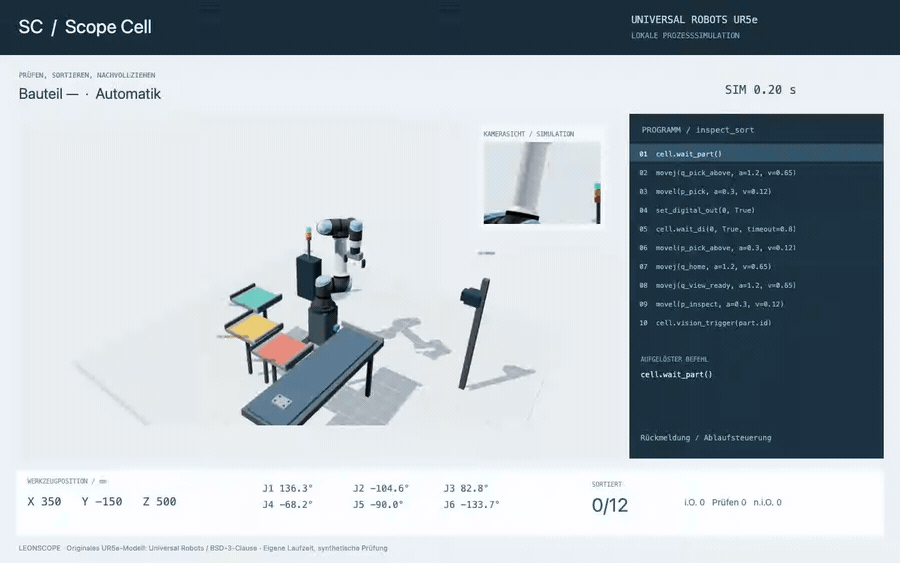
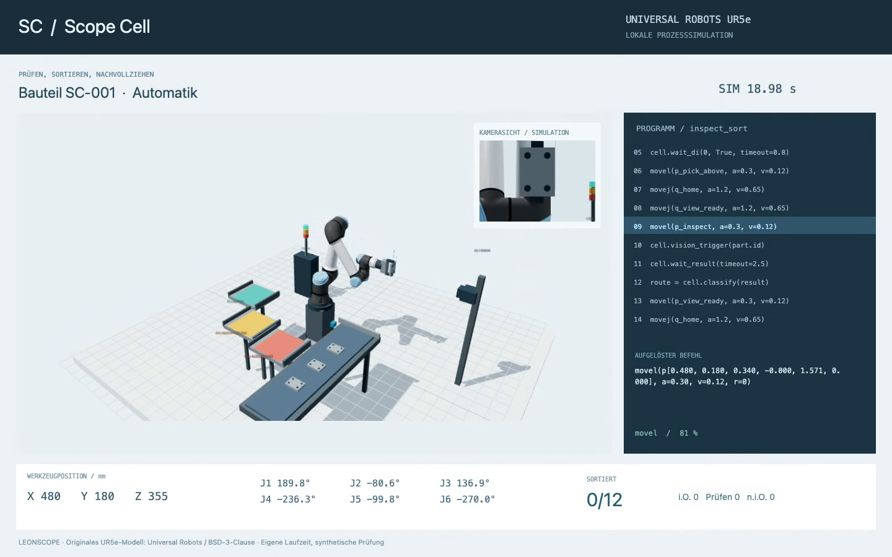

# Scope Cell

[English](README.md) · **Deutsch**

### Eine Roboterzelle, deren Ablauf sich Schritt für Schritt nachvollziehen lässt.

Ein Universal Robots UR5e nimmt ein Bauteil vom Band, dreht die Prüffläche zur Kamera und legt es im zugewiesenen Fach ab. Parallel zeigt Scope Cell den aktiven Befehl, alle sechs Achswinkel, die Werkzeugposition und die Rückmeldungen, auf die der nächste Schritt wartet.

Die lokale Simulation habe ich mit Codex entwickelt. Sie verbindet meine Erfahrung mit Robotik und kameragestützter Prüfung mit einem interaktiven Softwareprojekt. Zelle und Bauteile sind fiktiv; Konstruktionen oder Betriebsdaten eines Arbeitgebers werden nicht verwendet.

*Aufgenommen in der laufenden Anwendung. Die Vorschau läuft dreifach beschleunigt; das [45-Sekunden-Video](assets/scope-cell-ur5e-demo.mp4) zeigt den Ablauf bei 1×. Das kleine Kamerafenster zeigt die 3D-Szene aus Sicht der simulierten Prüfkamera.*

## Was die Demo kann

- **Die Bewegung folgt dem Befehl.** Gelenkfahrten und gerade Werkzeugbahnen steuern Modell, Telemetrie und Fortschrittsanzeige aus demselben Zustand.
- **Die Entnahme gehört zum Ablauf.** Das Bauteil fährt bis zum Anschlag. Der Greifer senkt sich ab, schließt, wartet auf seine Rückmeldung und hebt das Teil vor dem Weitertransport senkrecht an.
- **Die Kamera bekommt freie Sicht.** Der Roboter dreht die Prüffläche zur seitlichen Kamera. Vor der Prüfung kontrolliert das Modell die Ausrichtung und fünf Sichtlinien.
- **Störungen unterbrechen die Folge.** Bleibt ein Kamerasignal aus, hält der Roboter das Bauteil. Ein volles Fach sperrt die Ablage. Nach dem Beheben der Ursache muss der Bediener ausdrücklich fortsetzen.
- **Jedes Bauteil hat einen Verlauf.** Seine Kennung verbindet Prüfung, Fachauswahl und Ablage. Das vollständige Laufprotokoll lässt sich lokal exportieren.

Für den Roboter werden das originale **UR5e-Modell und die nominale Gelenkgeometrie von Universal Robots** verwendet. Greifer, Förderband, Kamera und Fächer sind vereinfachte Demobauteile. Scope Cell berechnet die Bewegung in einer eigenen Laufzeit. Es laufen weder URSim noch ein Universal-Robots-Controller. Die Befehlsanzeige orientiert sich an URScript; `cell.*` steuert die eigene simulierte Anlage.

## Die Pose vor der Kamera

Das Prüfergebnis ist ein reproduzierbar erzeugter Testwert. **Dieses Projekt enthält kein Bilderkennungsmodell.** Die Kamerasicht macht die Pose überprüfbar; sie erzeugt keine Klassifikation.

## Geprüfter Stand

**47 automatisierte Prüfungen bestanden** unter Node 24 und 25. Sie betreffen Bewegung, Bauteilverfolgung, Wiederaufnahme nach Störungen und Geometrie. Dazu gehört eine absichtlich durch das Förderband geplante Fahrt, die zurückgewiesen werden muss. Die vollständigen Browserläufe stimmten außerdem mit den Ergebnissen der lokalen Ablaufberechnung überein.

| Gleiche Charge mit 12 Bauteilen | Normale Prüfung | Langsame Prüfung |
| --- | ---: | ---: |
| Kameraverzögerung im Modell | 1,1 s | 6,0 s |
| Gesamte Simulationszeit | 498,74 s | 557,58 s |
| Durchsatz im Modell | 86,6 Teile/h | 77,5 Teile/h |
| Sortierergebnis | 8 i. O. / 1 Nachprüfung / 3 n. i. O. | 8 i. O. / 1 Nachprüfung / 3 n. i. O. |

Die Zahlen beschreiben diese fiktive Zelle mit den gewählten Zeiten. Sie sind keine Leistungsangaben zum UR5e und keine Messungen einer realen Anlage. [Prüfungen, Einstellungen und Grenzen](docs/VERIFICATION.de.md).

Die [Fallstudie](docs/CASE_STUDY.de.md) erklärt, wie Bewegung, Verriegelungen und sichtbare Befehle zusammenarbeiten.

## Veröffentlichung und Rechte

Dieses Repository enthält **nur die Präsentation**. Quellcode, ausführbare Anwendung, lokale Modellkopien, Konfigurationen und detaillierte Testexporte bleiben privat. Eine öffentliche Webanwendung wird nicht bereitgestellt.

Das eigene Portfolio-Material wird nicht unter einer Open-Source- oder Creative-Commons-Lizenz angeboten. Siehe [Rechte](RIGHTS.md). Die UR5e-Geometrie stammt von den ursprünglichen Autoren und ist separat unter BSD-3-Clause verfügbar; deren Lizenz bleibt bestehen. Siehe [Modellquelle und Drittanbieterhinweis](THIRD_PARTY_NOTICES.md).

Ein unabhängiges Projekt von **LeonScope**, entwickelt mit Codex. Es besteht keine Partnerschaft oder Freigabe durch Universal Robots.
