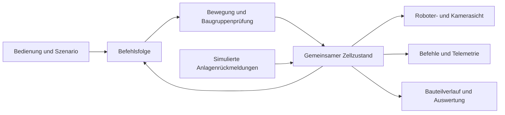

# Eine Roboterzelle mit nachvollziehbarem Verhalten

[English](CASE_STUDY.md) · [Projekt](../README.de.md)

Ausgangspunkt war ein vertrauter Prozess: ein gefrästes Bauteil von einer Linie nehmen, vor einer Kamera prüfen und nach dem Ergebnis sortieren. Die Portfolio-Demo sollte auch die Arbeit zwischen diesen Schritten zeigen. An einem bewegten Roboter allein erkennt man weder den Grund für eine Wartezeit noch das Bewegungsziel oder die Folgen einer Störung.

## Ein Ablauf, mehrere Ansichten

Scope Cell hält Befehl, Roboterposition, Anlagensignale und Bauteilkennung in einem gemeinsamen Prozesszustand. Die Darstellung liest diesen Zustand. Sie spielt keine getrennte Animation ab, die der Befehlsanzeige vorauseilen könnte.

Die Oberfläche unterscheidet Gelenkfahrten von einer geraden Werkzeugbahn. Sie zeigt das aufgelöste Ziel und den Fortschritt. Die sechs Achswerte und Werkzeugkoordinaten folgen derselben Berechnung. Die `cell.*`-Befehle beschreiben Förderband, Greiferrückmeldung, Prüfung und Sortierung dieser Demo.

## Eine mechanisch nachvollziehbare Folge

Die Entnahmehöhe stimmt mit der Bandoberfläche überein; die Greiferöffnung passt zum Bauteil. Der Roboter hebt zunächst senkrecht an, fährt über eine höhere Transferposition und dreht die Prüffläche zur seitlichen Kamera. Nach der Prüfung zieht er das Bauteil zurück, bevor er das ausgewählte Fach anfährt. Jede Ablage hat einen eigenen Platz, einschließlich der Höhe weiterer Lagen.

Bei der visuellen Prüfung wurden Fehler sichtbar, die eine erfolgreiche Bahnberechnung allein nicht aufdeckte: zu wenig Freiraum an Baugruppen, eine unpassende Entnahmehöhe und eine Kameraperspektive in Richtung Handgelenk. Im überarbeiteten Aufbau nutzen Darstellung und Prüfung dieselben Baugruppendefinitionen. Die Hüllkörper der Roboterkomponenten werden aus der Originalgeometrie abgeleitet. Eine absichtlich durch das Förderband geplante Fahrt muss zurückgewiesen werden. Dieser Gegenversuch deckte bei der Entwicklung auch einen Fehler bei der Transformation außermittiger Hüllkörper auf.

Die Prüfung hat klare Grenzen: Vereinfachte Hüllkörper werden an Stichproben entlang der Bahn gegen ausgewählte feste Baugruppen geprüft. Das hilft bei dieser Demo, ist aber kein vollständiges Kollisionsmodell und kein Werkzeug zur Anlagenfreigabe.

## Das Bauteil bleibt bei einer Störung erhalten

Bei einem Kamera-Timeout bleibt das aktuelle Bauteil in der Prüfpose am Greifer. Nach dem Verbinden und Quittieren wird die Prüfung für dieselbe Kennung wiederholt; die Zelle bleibt zunächst pausiert. Ein volles Ausgabefach sperrt die Freigabe, bis es geleert wurde und der Bediener fortsetzt. Eine Ablage wird pro Bauteil genau einmal verbucht.

Auch ein Zuführereignis gehört zum neu eintreffenden Bauteil, während der Roboter möglicherweise ein anderes bearbeitet. Nur so lässt sich eine einzelne Kennung durch die laufende Zelle verfolgen.

## Zeiten werden sichtbar

Ein Puffer für drei Bauteile macht die Folgen einer langsamen Prüfung erkennbar. Steigt die Kameraverzögerung von 1,1 auf 6 Sekunden, dauert die Charge länger. Bauteile und Prüfergebnisse bleiben dabei gleich. Das Abspielen bei 8× verkürzt die Betrachtung, ohne das Simulationsergebnis zu verändern.

Die Oberfläche kombiniert eine helle Arbeitsansicht mit einem dunkleren Programmfenster und zurückhaltenden Statusfarben. Auf schmalen Bildschirmen stehen Zelle und Programm untereinander. Der Ablauf lässt sich aus mehreren Perspektiven ansehen, pausieren oder befehlsweise ausführen.

## Mein Anteil und der Einsatz von KI

Ich habe Szenario und Anforderungen festgelegt, das mechanische Verhalten geprüft und die Überarbeitung gesteuert. Codex hat bei Umsetzung, Fehlersuche, Tests und Dokumentation unterstützt. Die UR5e-Geometrien und nominalen Kinematikdaten stammen von Universal Robots und sind gesondert ausgewiesen. Die übrigen Demobauteile und die Anwendung gehören zu diesem Projekt.

Die Anwendung nutzt TypeScript, React und Three.js. Sie läuft lokal und hat keine Verbindung zu einem Roboter. Quellcode und detaillierte Testunterlagen bleiben privat; diese Präsentation zeigt das Ergebnis und seine Grenzen.
