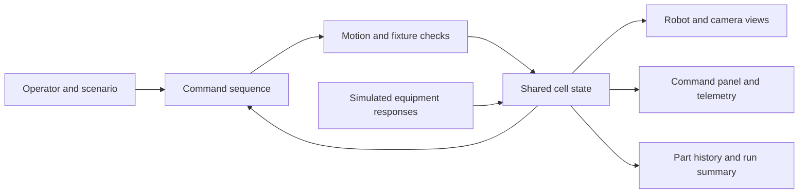
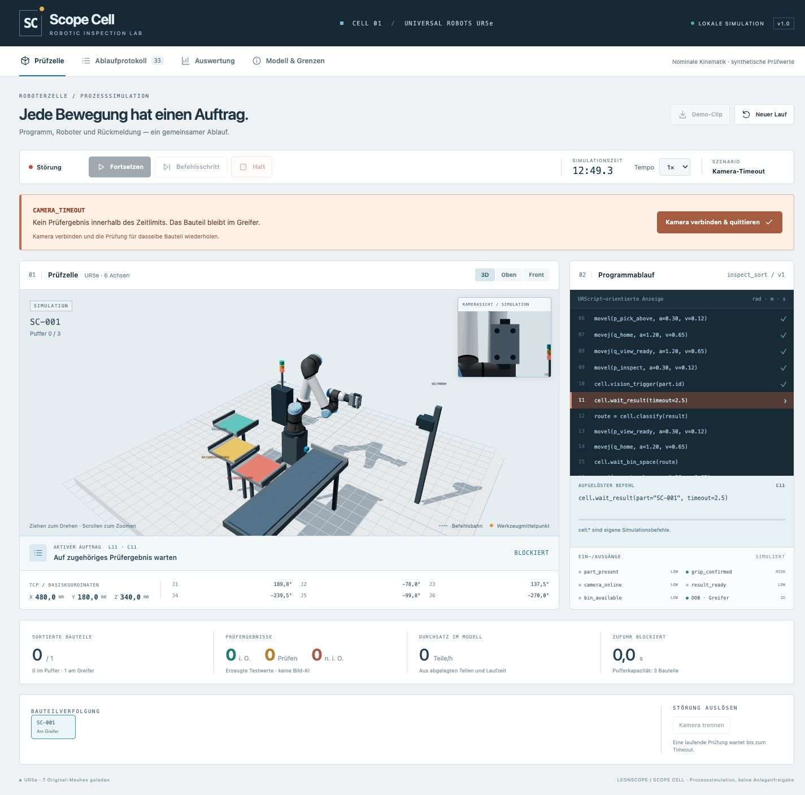
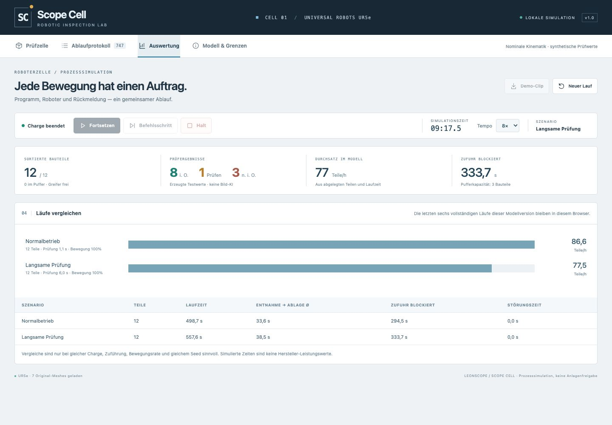

# Building a cell whose behavior can be inspected

[Deutsch](CASE_STUDY.de.md) · [Project](../README.md)

My starting point was a familiar process: take a machined part from a line, show it to a camera and sort it by the result. I wanted the portfolio demo to explain the work between those steps. A moving robot alone would not show why it waits, what it is trying to reach or how a fault affects the part.

## One sequence, several views

Scope Cell keeps the command, robot position, equipment signals and part identity in one process state. The renderer reads that state. It does not run a separate animation that can get ahead of the command display.

The interface distinguishes joint motion from a straight tool path. It shows the resolved target and progress, while the six axes and tool coordinates change with the same calculation. The `cell.*` operations describe the conveyor, gripper feedback, inspection and routing logic used by this demo.

## Getting the mechanics to make sense

The pickup height matches the belt surface and the gripper opening matches the part. The robot lifts straight up, moves through a higher transfer position and rotates the face toward a camera mounted to the side. After inspection it withdraws before moving to the selected bin. Each placement has its own slot, including the height of subsequent layers.

Visual review exposed errors that a successful path calculation alone did not catch: clearance around the fixtures, a poor pickup height and a camera angle that looked toward the wrist. The revised layout uses the same fixture definitions for rendering and checks. Robot component envelopes come from the original model geometry. A negative test sends a deliberately invalid path through the conveyor and verifies rejection. This also caught an error in transforming off-center bounding boxes during development.

The checks remain deliberately limited: they sample simplified envelopes against selected fixed assemblies. They are useful for this demo, but they are not a complete collision model or a commissioning tool.

## Keeping the part through a fault

A camera timeout leaves the current part held at the inspection pose. Reconnecting and acknowledging the camera retries the inspection for that same identifier, then leaves the cell paused. A full output bin blocks release until the bin is cleared and the operator resumes. Placement is recorded once per part.

Arrival events also belong to the incoming part, even when the robot is handling another one. That matters when following a single identifier through a busy cell.

## Making timing visible

A three-part input buffer exposes the effect of a slow downstream step. Increasing the camera delay from 1.1 to 6 seconds raises total batch time while preserving the same parts and quality outcomes. Playback at 8× makes the experiment quicker to watch without changing simulated results.

The interface uses a light industrial workbench, a darker program panel and restrained status colors. On a narrow screen the cell and program stack vertically. The operator can inspect the scene from several views, pause it or advance one command.

## My role and the use of AI

I set the scenario and acceptance criteria, reviewed the mechanical behavior and directed the revisions. Codex assisted with implementation, debugging, tests and documentation. The UR5e meshes and nominal kinematic data come from Universal Robots and are credited separately. The fixture models and application are part of this project.

The working app uses TypeScript, React and Three.js. It runs locally and has no robot connection. The source and detailed test material remain private; this presentation shows the result and describes its limits.
